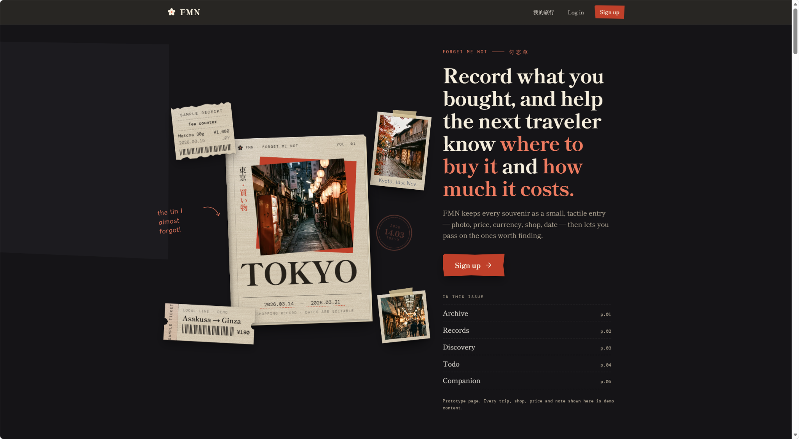
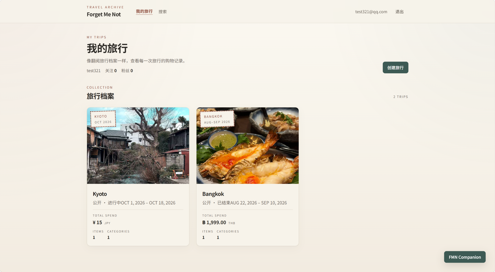
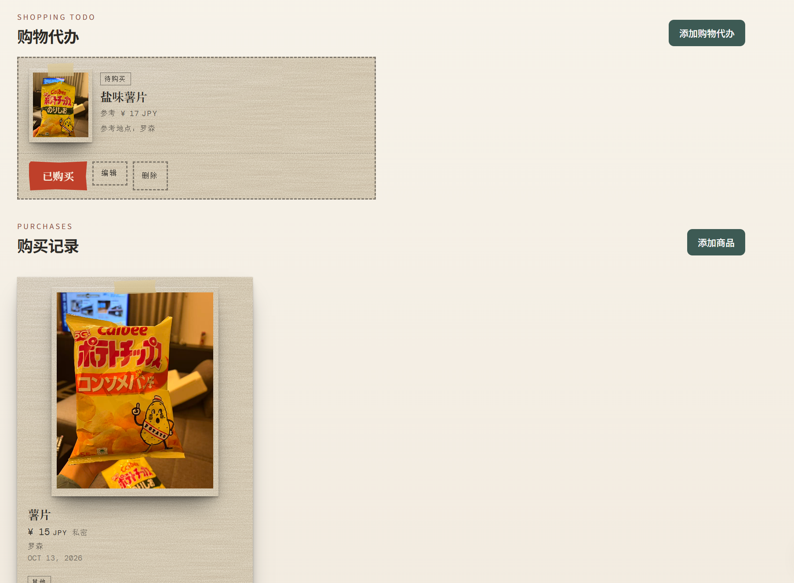
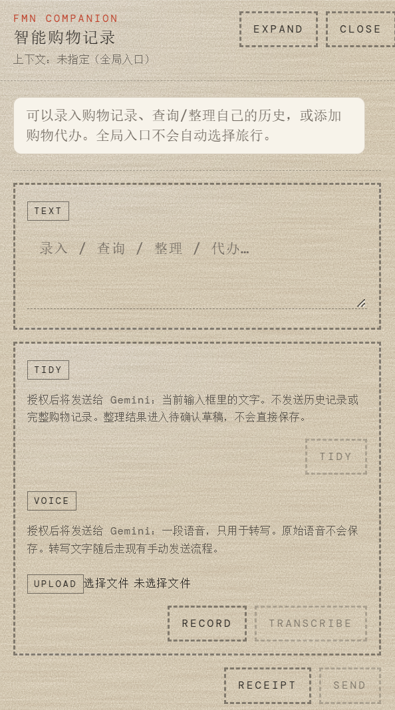
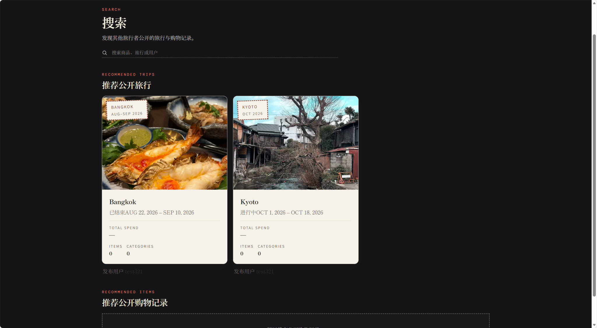

# Forget Me Not (FMN)

> 记录你买过的，也帮助下一位旅行者知道该在哪里买、多少钱。

**[Live Demo](https://fmn-omega.vercel.app/) · [GitHub Repository](https://github.com/potsurii/FMN)**

Forget Me Not (FMN) is a travel-shopping record and sharing web app. It helps travelers record what they bought, how much they paid, where they purchased it, and when the purchase happened—turning personal shopping experiences into useful references for future travelers.

## Overview

Travel shopping information is often scattered across photos, receipts, notes, and memory. FMN organizes these details around trips and products so users can revisit their own records and share useful purchase information.

The product focuses on **travel-shopping records and reference information** rather than e-commerce transactions.

## Features

- **Trip-based records** — organize shopping records by trip, with trip dates and a cover image.
- **Purchase details** — record product name, price, currency, purchase location, date, category, image, and notes.
- **Trip summaries** — review spending and record counts within a trip.
- **Shopping to-dos** — keep track of products to look for before or during a trip.
- **Community recommendations** — share whether a product is recommended or not recommended.
- **AI Companion** — assist with supported record and to-do workflows. Proposed changes are reviewed and explicitly confirmed before formal writes.

> Availability of individual features may depend on the current deployment configuration.

## Tech Stack

| Area | Technology |
| --- | --- |
| Web framework | Next.js 15 |
| UI | React 19, TypeScript |
| Styling | Tailwind CSS 4 |
| Authentication and database | Supabase |
| Server/client Supabase integration | `@supabase/ssr`, `@supabase/supabase-js` |
| AI provider integration | Google Gemini API |
| Icons | lucide-react |
| Deployment | Vercel |

## Engineering Highlights

### Authentication-aware data access

FMN uses Supabase authentication and server/client integrations. Protected-page access is handled through session-aware middleware, while database access must follow the configured Supabase authorization policies.

### Trip-based visibility boundaries

Trip visibility determines whether the associated shopping records can be shared publicly. A private trip should not expose its items as public records.

### Explicit confirmation for AI-assisted writes

The AI Companion is designed as a constrained workflow helper, not an unrestricted chatbot or autonomous database writer. It can prepare drafts for supported actions, while formal changes remain behind explicit review and confirmation flows.

### Bounded agent orchestration

The Companion's model/tool workflow uses a bounded loop to limit repeated execution. Model instructions and available tools are defined on the server rather than trusted from browser input.

### Repeatable project checks

The repository includes scripts for selected implementation batches and architecture/boundary checks. Run the commands below in the local project to verify the current checkout.

## Screenshots

Screenshots are optional, but real screenshots can help readers understand the product quickly. Add screenshots captured from the actual application to `docs/screenshots/`, then replace the placeholders below with the real filenames.

## Screenshots

### Landing Page

The travel-inspired editorial homepage introduces FMN's core idea: preserving shopping memories and sharing useful purchase information.



### My Trips

Organize travel experiences into a personal archive with trip dates, cover photos, spending summaries, and shopping records.



### Shopping Records

Keep track of shopping to-dos and purchased items, including product photos, prices, currencies, purchase locations, and dates.



### AI Companion

Use the AI Companion to assist with supported shopping-record, history-search, and to-do workflows, with review and confirmation before formal changes.



### Discovery

Explore public trips and shopping records shared by other travelers.



## Getting Started

### Prerequisites

- Node.js and npm
- A Supabase project configured for the application's database, authentication, storage, and authorization policies
- A Google Gemini API key if you want to use AI Companion functionality

### 1. Clone the repository

```bash
git clone https://github.com/potsurii/FMN.git
cd FMN
```

### 2. Install dependencies

```bash
npm install
```

### 3. Configure environment variables

Create a `.env.local` file in the project root:

```dotenv
NEXT_PUBLIC_SUPABASE_URL=
NEXT_PUBLIC_SUPABASE_ANON_KEY=
GEMINI_API_KEY=
```

| Variable | Purpose | Exposure |
| --- | --- | --- |
| `NEXT_PUBLIC_SUPABASE_URL` | Supabase project URL | Available to browser code |
| `NEXT_PUBLIC_SUPABASE_ANON_KEY` | Supabase public/anonymous key | Available to browser code; database access must be protected by appropriate Supabase policies |
| `GEMINI_API_KEY` | Gemini API authentication | Keep server-side; never expose it through a `NEXT_PUBLIC_` variable |

Use your own project credentials. Never commit `.env.local` or publish private API keys.

### 4. Configure Supabase

Configure the Supabase database schema, authorization policies, authentication settings, and storage buckets required by the application. The repository includes a `supabase/config.toml` file, but a working deployment also depends on the corresponding project configuration.

### 5. Run the development server

```bash
npm run dev
```

Open [http://localhost:3000](http://localhost:3000).

### 6. Build and run for production

```bash
npm run build
npm run start
```

## Available Checks

Run these commands from the project root:

```bash
npm run lint
npm run typecheck
npm run phase3:check
npm run architecture:scan
```

The repository also defines targeted verification scripts for implementation batches, for example:

```bash
npm run test:batch1
npm run test:batch3
npm run test:batch5s1
npm run test:batch5s3
```

These are repository-provided checks; their presence does not imply that every check has been run successfully in every environment.

## Project Structure

```text
.
├── app/                       # Next.js routes and pages
├── components/                # UI components
├── lib/
│   ├── supabase/              # Supabase client/server/session integration
│   └── providers/
│       └── gemini/            # Gemini provider configuration
├── scripts/                   # Verification and architecture-check scripts
├── supabase/                  # Supabase project configuration
├── middleware.ts              # Session-aware request handling
├── next.config.ts             # Next.js configuration
├── package.json               # Dependencies and scripts
└── tsconfig.json              # TypeScript configuration
```

This is a high-level guide; consult the repository for the current implementation details.

## Deployment

The application has a Vercel deployment entry point:

**[Open FMN Live Demo](https://fmn-omega.vercel.app/)**

The live URL is provided for trying the application. Its availability and individual feature behavior may vary with deployment status and external service configuration.

## License

No root-level `LICENSE` file was confirmed when this README was prepared. Unless a license is added to the repository, do not assume that the code is licensed for unrestricted reuse.
